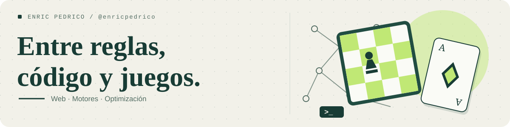

<picture>
  <source media="(prefers-color-scheme: dark)" srcset="./assets/header-dark.svg">
  <source media="(prefers-color-scheme: light)" srcset="./assets/header-light.svg">
  
</picture>

# Enric Pedrico

Construyo **juegos y aplicaciones web**, y experimento con **motores de decisión y modelos de optimización**. Me gusta convertir reglas, ideas y problemas concretos en proyectos que se puedan probar.

[Explorar proyectos](#proyectos-para-probar) · [Todos los repositorios](https://github.com/enricpedrico?tab=repositories)

## Proyectos para probar

<table>
<tr>
<td width="50%" valign="top">

### LleidaPeix

Botifarra occidental para jugar, entrenar y analizar decisiones. El motor trabaja con la información que conoce el jugador.

**Rust · React · SQLite**

[Probar ↗](https://botifarra.pedrico.cat) · [Código](https://github.com/enricpedrico/lleidapeix)

</td>
<td width="50%" valign="top">

### Pirescacs

Ajedrez de piratas con reglas propias, editor de posiciones y un motor de análisis que funciona en el navegador.

**C++ · WebAssembly · React**

[Probar ↗](https://pirescacs.pedrico.cat) · [Código](https://github.com/enricpedrico/pirescacs)

</td>
</tr>
<tr>
<td width="50%" valign="top">

### Eleven Force

Proyecto fan de draft futbolístico: modo individual, salas temporales, selección de plantillas y torneos.

**TypeScript · React · Node.js**

[Probar ↗](https://7a0.pedrico.cat) · [Código](https://github.com/enricpedrico/eleven-force)

</td>
<td width="50%" valign="top">

### Zona Zero

Simulaciones reproducibles de supervivencia para 2–50 participantes. Una PWA con los datos guardados en el navegador.

**TypeScript · React · PWA**

[Probar ↗](https://war.pedrico.cat) · [Código](https://github.com/enricpedrico/zona-zero)

</td>
</tr>
</table>

## Otros experimentos

- **[Chess Bot](https://github.com/enricpedrico/chess_bot)** — Motor de ajedrez en Python: posiciones FEN, generación de movimientos y evaluación.
- **[TFG](https://github.com/enricpedrico/TFG)** — Modelos de optimización en MiniZinc, generación de casos de prueba en Python y comparación de solvers.

## Tecnologías en estos proyectos

**Web:** TypeScript, JavaScript, React y Node.js. 
**Motores y modelos:** Rust, C++, WebAssembly, Python y MiniZinc. 
**Datos y despliegue:** SQLite, Docker y Caddy.
